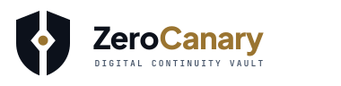
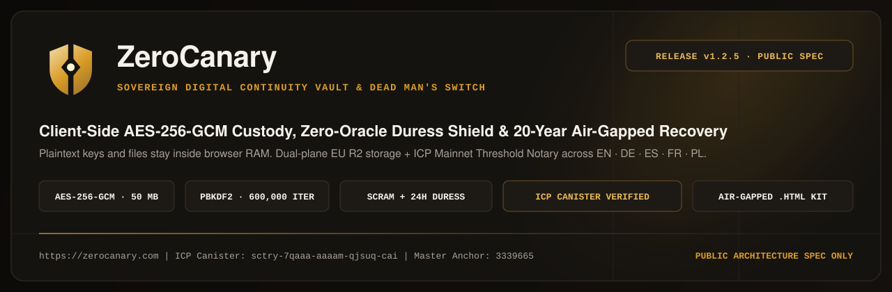
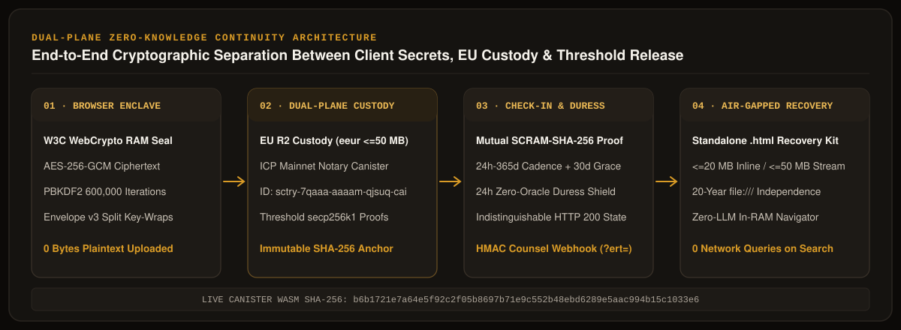

  <a href="https://zerocanary.com">
    <picture>
      <source media="(prefers-color-scheme: dark)" srcset="assets/logo-dark.svg" />
      
    </picture>
  </a>

  

  
  
  
  
  
  
  

  
  
  
  
  
  
  
  

---

# ZeroCanary

**Client-side encrypted fiduciary continuity vault, Dead Man's Switch, and 20-year air-gapped recovery architecture for private individuals, founders, family offices, and legal counsel worldwide — delivered natively across 5 languages (`EN`, `DE`, `ES`, `FR`, `PL`) and 17 canonical routes (`85` localized SSR HTML URLs).**

ZeroCanary enables asset owners to seal succession directives, recovery credentials, hardware-wallet descriptors, corporate continuity directives, and multi-file binary archives (`.pdf`, `.zip`, `.7z`, `.key`, `.jpg`, `.docx`, up to `50 MB` per deposit, automatically bundled in-browser) before any byte leaves their device — verifiable live in browser memory before committing a single byte to storage. No user account, email registration, tracking cookies, or vendor plaintext custody is required.

> **Repository Scope (Public Specification & Brand Identity Only):** This public repository publishes **only** architectural documentation, independent cryptographic verification references, coordinated vulnerability disclosure policy (`SECURITY.md`), and official brand vector graphics. Production edge runtime, ICP Mainnet canister sources, and client enclaves reside in private sovereign infrastructure operated by Gexiro Global Enterprises Ltd (`0` source code hosted here).

---

## Visual Continuity Flow

  

---

## Core Cryptographic & Dual-Plane Continuity Architecture

| Capability | Technical Implementation | Operational Guarantee |
| :--- | :--- | :--- |
| **Client-Side Zero-Knowledge Sealing (`<= 50 MB` Multi-File)** | Native W3C WebCrypto (`AES-256-GCM`, `PBKDF2-HMAC-SHA-256` at `600,000` iterations, `HKDF-SHA-256`) + in-browser multi-file `PKZIP` bundling | Plaintext files, notes, and passphrases never leave browser RAM (`0 bytes sent` in sandbox and continuity score evaluations). |
| **Dual-Plane EU Custody & Threshold Notary** | Sovereign European Union zero-knowledge ciphertext storage (`EU eeur`) + hardened ICP Mainnet Threshold Notary canister (`sctry-7qaaa-aaaam-qjsuq-cai`, `v1.2.4` + edge `v1.2.5`) | Zero plaintext visibility at the storage layer paired with immutable `SHA-256` commitments and deterministic `secp256k1` release attestations. |
| **Envelope v3 Three-Role Key Separation** | Independent DEK key-wrapping across Owner Main, Recipient Online (`wrappedReleaseKeyB64` time-lock share), and Air-Gapped Offline (`offlineAirgapWrap`) roles | Heirs or legal counsel receive a dedicated **Recipient Unlock Password** without sharing the **Owner Main Password** or **Emergency Duress Password**. |
| **Replay-Resistant Two-Way Check-Ins** | Mutual challenge-response `SCRAM-SHA-256` proofs bound to action, payload digest, timestamp, and single-use server nonces | Owners prove liveness (`24h` to `365d`), rotate ciphertext instructions, and manage attachments while preserving recipient key-wraps. |
| **Zero-Oracle Coercion Shield (Plausible Deniability)** | Indistinguishable `HTTP 200` `HEARTBEAT_VERIFIED` duress flow + decoy cover note + decoy offline kit + `24h` public `423 Locked` shield + constant-size canister telemetry | Under physical or border coercion, an adversary sees a valid check-in and harmless cover note while authorized counsel receives an HMAC-signed webhook (`?ert=`). |
| **Client-Side Zero-LLM In-RAM Navigator (`Ctrl/Cmd+K`)** | Deterministic local index + 5-language BM25 and 13-rule intent matcher executed strictly inside browser memory | Instant navigation across routes, protocols, and FAQs with **`0` network queries** and zero prompt-exfiltration surface. |
| **Standalone Air-Gapped Offline Recovery Kit (`.html`)** | Self-contained, zero-dependency HTML + W3C WebCrypto decryptor with built-in 5-language UI (`EN`, `DE`, `ES`, `FR`, `PL`) | Embeds ciphertext up to `20 MB` directly inside `.html` for 20-year offline `file:///` decryption and streams larger `20-50 MB` archives after release. |
| **Zero-Cookie, Zero-IP Edge Telemetry & Fail-Closed Guardrails** | Aggregated same-origin funnel metrics (`0` cookies, `0` IP storage) + edge request size caps (`256 KB` webhook guard), fetch timeouts, and per-endpoint rate limits | Privacy-preserving operational telemetry without behavioral fingerprinting or payload logging. |

---

## Public Cryptographic Verification

External auditors and fiduciaries can independently verify ZeroCanary's live Mainnet threshold notary boundary using the public parameters published below (see [ARCHITECTURE.md](ARCHITECTURE.md) for the full verification protocol):

| Verification Anchor | Live Public Value |
| :--- | :--- |
| **ICP Mainnet Canister ID** | `sctry-7qaaa-aaaam-qjsuq-cai` |
| **Master Governance Anchor** | `3339665` |
| **Live Canister Wasm SHA-256** | `b6b1721e7a64e5f92c2f05b8697b71e9c552b48ebd6289e5aac994b15c1033e6` |
| **Threshold ECDSA Public Key (`secp256k1`, compressed)** | `036e0032b752069dee0dbc076a4c4705e336199880678d0602340e56f304f1f96d` |
| **Active Edge Production Release** | `v1.2.7-sovereign-social-mesh` |
| **Public SHA-256 Proof Verifier** | [https://zerocanary.com/tools/sha256-notary](https://zerocanary.com/tools/sha256-notary) |

---

## Continuity Plans & Global Multi-Currency Settlement

ZeroCanary operates globally across **5 localized SSR languages (`EN`, `DE`, `ES`, `FR`, `PL`)** on anonymous bearer continuity passes (`ZC-...`) with zero personal accounts or recurring subscription traps — backed by a **14-day unused pass refund guarantee** and **20-year standalone `.html` offline recovery independence**.

| Tier | Cadence & Scope | Multi-Currency Settlement (`USD · EUR · PLN · USDC · ICP`) |
| :--- | :--- | :--- |
| **Evaluation Sandbox** | `$0` · `1-hour` test cadence · live WebCrypto encryption, three-role passwords & offline kit verification | Instant access (`No card required`) |
| **ZeroCanary Solo Pass (`SOLO`)** | `$39` (`~$3.25/mo`) · `€36` (`~€3/mo`) · `159 PLN` (`~13 PLN/mo`) (`12m` one-time) · `1` active deposit · `24h-365d` cadences · `<= 50 MB` multi-file attachments + `30-day` grace | **Active:** Stripe (`Card`, `Apple/Google Pay`, `SEPA EUR`, `BLIK/P24 PLN`) + **On-Chain `USDC`** (`Base`, `Arbitrum`, `Ethereum`) |
| **Private Sovereign Pass (`SOVEREIGN`)** | `$49 / €45 / 199 PLN` (`3m`) · `$89 / €82 / 359 PLN` (`6m`) · `$149 / €139 / 599 PLN` (`12m`) · up to `10` active deposits · `24h-365d` cadences · `<= 50 MB` archives + `30-day` grace | **Active:** Stripe (`Card`, `Apple/Google Pay`, `SEPA EUR`, `BLIK/P24 PLN`) + **On-Chain `USDC`** + **`ICP Ledger`** |
| **Law Firm & Family Office (`COUNSEL`)** | `$490` · `€450` · `1,990 PLN` (`12m`) · **unlimited** active client deposits · `<= 50 MB` archives · HMAC webhook automation, B2B VAT invoice & **14-Day Law Firm Pilot** | **Active:** Stripe Institutional B2B VAT Checkout + **On-Chain `USDC`** + **`ICP Ledger`** · Pilot via [`/for-law-firms`](https://zerocanary.com/for-law-firms) |
| **Non-Custodial On-Chain Settlement** | Direct ERC-20 **`USDC`** (`Base`, `Arbitrum`, `Ethereum`) and native **`ICP Ledger`** settlement with pre-image intent protection & instant bearer pass issuance | **Active:** Automated On-Chain Receipt & Intent Proof Claim |

---

## Documentation & Machine-Readable Specifications

- **Technical Architecture & Verification Guide:** [ARCHITECTURE.md](ARCHITECTURE.md)
- **Coordinated Vulnerability Disclosure Policy:** [SECURITY.md](SECURITY.md) · [`/.well-known/security.txt`](https://zerocanary.com/.well-known/security.txt)
- **Live Enclave & Continuity Console (`EN | DE | ES | FR | PL`):** [https://zerocanary.com](https://zerocanary.com)
- **Law Firms & Fiduciary Counsel:** [`/for-law-firms`](https://zerocanary.com/for-law-firms) · [Deutsch: `/fuer-kanzleien`](https://zerocanary.com/fuer-kanzleien)
- **Architecture & Threat-Model Comparisons:** [https://zerocanary.com/compare](https://zerocanary.com/compare)
- **Institutional Press & Official Brand Kit:** [https://zerocanary.com/press](https://zerocanary.com/press)
- **Continuity Tools (`SHA-256 Notary` & `Continuity Score`):** [`/tools`](https://zerocanary.com/tools)
- **Architecture Briefings:** [https://zerocanary.com/briefings](https://zerocanary.com/briefings)
- **Multilingual Sitemap (`85` Canonical HTML URLs + `llms.txt` + `RSS`):** [https://zerocanary.com/sitemap.xml](https://zerocanary.com/sitemap.xml) · [https://zerocanary.com/llms.txt](https://zerocanary.com/llms.txt) · [https://zerocanary.com/feed.xml](https://zerocanary.com/feed.xml)
- **Official Channels:** [LinkedIn Showcase](https://www.linkedin.com/showcase/zerocanary/) · [X `@zerocanary_com`](https://x.com/zerocanary_com) · [Bluesky `@zerocanary.com`](https://bsky.app/profile/zerocanary.com) · [Fediverse `@zerocanary@zerocanary.com`](https://social.zerocanary.com/@zerocanary) · [Nostr NIP-05 `_@zerocanary.com`](https://zerocanary.com/.well-known/nostr.json)

---

## Legal & Governance

Operated by **[Gexiro Global Enterprises Ltd](https://gexiro.com)** (Gibraltar). European Union sovereign zero-knowledge ciphertext custody paired with decentralized ICP Mainnet threshold timestamp notarization.

© Gexiro Global Enterprises Ltd. All rights reserved.